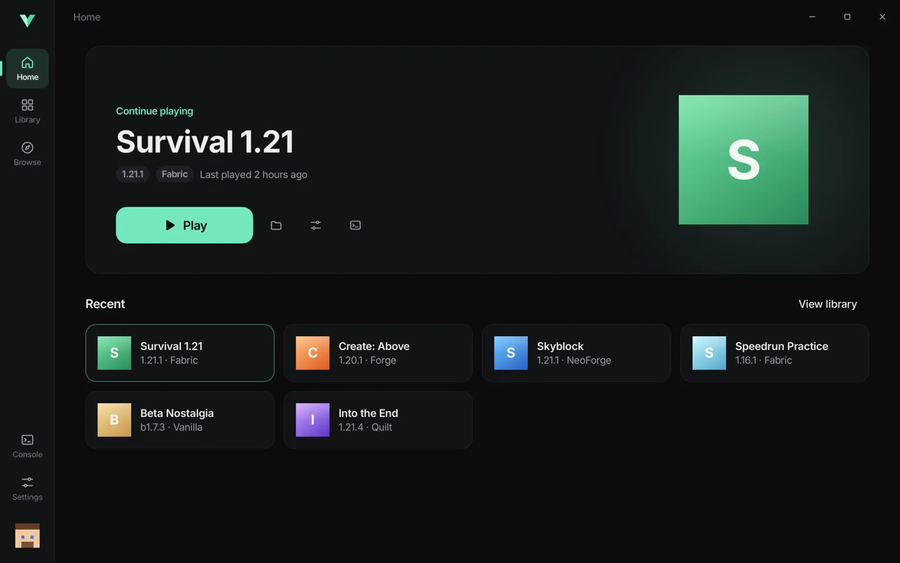
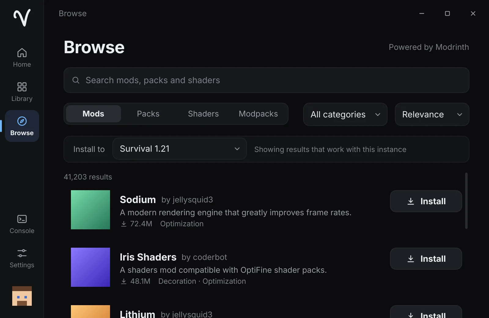
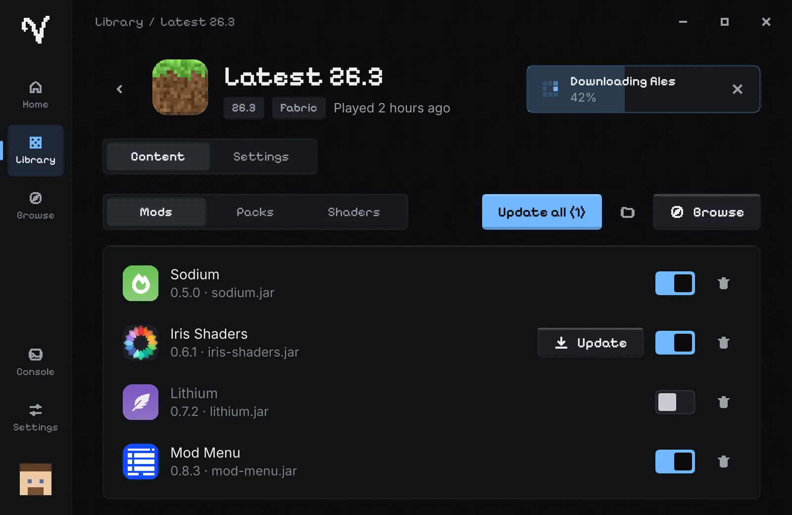

<p align="center">
  
</p>

<h1 align="center">Vanta</h1>

<p align="center">
  A fast, minimal, open-source launcher for Minecraft: Java Edition.<br>
  Native Rust + Slint. No browser engine. No telemetry.
</p>

<p align="center">
  <a href="https://github.com/Inpriv/vanta/releases/latest">Download</a> ·
  <a href="https://getvanta.xyz">Website</a> ·
  <a href="docs/ARCHITECTURE.md">Architecture</a> ·
  <a href="docs/PERFORMANCE.md">Performance</a>
</p>

<p align="center">
  
</p>

<p align="center">
  
  
</p>

## Features

- **Offline accounts**: pick a username and play. The same name always maps to the same player UUID, so inventories and progress persist, including on friends' LAN worlds.
- **Microsoft sign-in (coming soon in official builds)**: device code flow, multiple accounts, quick switching, automatic token refresh, tokens stored only in your OS keychain. It is fully implemented and works in builds made with an approved Azure client ID (see below); official releases will enable it once Vanta's app ID is approved. Online servers, skins and Realms need it. Please buy Minecraft to support Mojang.
- **One Play button for everything**: it fills with live progress while files download (MB/s, files left), then turns into a "Playing · 12:03" control with Stop.
- **Make it yours**: 22 original pixel-art block icons (grass, diamond ore, TNT, obsidian…), the Vanta mark or a letter tile in your accent color, plus six accent colors and light/dark themes.
- **Every version**: releases, snapshots and old betas/alphas from Mojang's official manifest.
- **Mod loaders**: Fabric, Quilt, Forge and NeoForge, including Forge/NeoForge installer processors.
- **Modrinth built in**: search mods, resource packs, shaders and modpacks with version/loader/category filters; dependencies install automatically; check for updates, enable/disable or remove content.
- **Modpacks**: import Modrinth `.mrpack` files and export your instances as `.mrpack`.
- **Java handled for you**: detects installed Java and downloads the right runtime per version (Mojang runtimes, Adoptium as fallback). Override per instance.
- **Fast downloads**: highly parallel, resumable, retried with backoff, SHA-1 verified, stored once in a shared content-addressed cache.
- **Live console** with level filtering, search and copy, plus a friendly crash screen that explains common failures.
- **Instances**: create, duplicate, rename, delete, pick an icon, per-instance memory, JVM arguments, resolution and Java.
- **Signed auto-updates** from GitHub Releases (minisign / Ed25519). Vanta always asks before installing.
- **Calm, original design**: dark and light themes, six accent colors, smooth 60+ fps motion, and a “Reduce motion” setting.

### Privacy

Vanta has **no telemetry and no analytics**. It only contacts Microsoft/Xbox (sign-in), Mojang (game files, Java), the mod loader sites (Fabric, Quilt, Forge, NeoForge), Adoptium (Java fallback), Modrinth (content) and GitHub (update checks, which you can turn off).

## Download

| Platform | Package |
| --- | --- |
| Windows | `Vanta-Setup-<version>.exe` (per-user installer) or `Vanta-<version>-portable.exe` |
| Ubuntu / Debian | `vanta_<version>_amd64.deb` (double-click to open in your software center) |
| Any Linux | `Vanta-linux-x86_64.tar.gz`: extract it and double-click `vanta`. Also: `Vanta-<version>-x86_64.AppImage` |
| Arch Linux | `vanta-<version>-x86_64.pkg.tar.zst` (`sudo pacman -U …`); an AUR package is coming soon |

Get them from the [latest release](https://github.com/Inpriv/vanta/releases/latest). Verify with `sha256sum -c SHA256SUMS.txt`.

**AppImage:** after downloading, allow it to run once — right-click → *Properties* → *Executable as program* (or `chmod +x Vanta-*.AppImage`) — then double-click it.

## Build from source

Requirements: Rust stable (1.92+). On Linux you also need the development packages for fontconfig, xkbcommon, Wayland and D-Bus:

```sh
# Debian / Ubuntu
sudo apt install build-essential pkg-config libfontconfig1-dev libxkbcommon-dev libwayland-dev libdbus-1-dev
# Arch
sudo pacman -S --needed base-devel fontconfig libxkbcommon wayland dbus
```

```sh
git clone https://github.com/Inpriv/vanta
cd vanta
VANTA_MSA_CLIENT_ID=<your-azure-client-id> cargo build --release
./target/release/vanta
```

Run the tests with `cargo test --workspace`. Network integration tests (real downloads from Mojang and the loader sites) are ignored by default: `cargo test -p vanta-core -- --ignored`.

### Microsoft sign-in setup

Signing in needs an Azure application ID that is approved for the Minecraft API. It is read at **build time** from `VANTA_MSA_CLIENT_ID` (see `.env.example`); nothing is hardcoded and no client secret is used.

1. Go to the [Azure portal → App registrations](https://portal.azure.com/#view/Microsoft_AAD_RegisteredApps/ApplicationsListBlade) and create a new registration.
2. Supported account types: **Personal Microsoft accounts only**.
3. Under **Authentication**, add the platform **Mobile and desktop applications** and enable **Allow public client flows** (needed for the device code flow).
4. Copy the **Application (client) ID**.
5. Request access to the Minecraft Services API for that application with Mojang's [form for new third-party apps](https://aka.ms/mce-reviewappid). Until it is approved, sign-in fails at the Minecraft step.
6. Build with `VANTA_MSA_CLIENT_ID=<client id>`. For releases, store it as the `VANTA_MSA_CLIENT_ID` GitHub Actions secret.

A build without a client ID still runs; account sign-in is disabled and explained in the UI.

## FAQ

**Do I need a Microsoft account?** Not right now: official builds use offline accounts while Microsoft sign-in is being approved. Once it is available, signing in with the account that owns Minecraft: Java Edition is recommended for online servers, skins and Realms.

**Will I keep my inventory?** Yes. An offline account's UUID is derived from its username (the same scheme vanilla Minecraft uses), so the same name is always the same player.

**Where is my data?** `~/.local/share/vanta` on Linux and `%APPDATA%\Vanta` on Windows. You can change it in Settings → Storage. Settings live in `~/.config/vanta` / `%APPDATA%\Vanta\settings.json`.

**Does it support macOS?** The code is portable, but macOS builds are not published yet.

**How do I report a security issue?** See [SECURITY.md](SECURITY.md).

## Contributing

Contributions are welcome. Read [CONTRIBUTING.md](CONTRIBUTING.md) and the [Code of Conduct](CODE_OF_CONDUCT.md).

## License

Vanta is licensed under the [GNU General Public License v3.0 or later](LICENSE). The bundled Inter typeface is licensed under the SIL Open Font License 1.1.

---

NOT AN OFFICIAL MINECRAFT PRODUCT. NOT APPROVED BY OR ASSOCIATED WITH MOJANG OR MICROSOFT. Vanta never redistributes Minecraft files; everything is downloaded from official sources.
